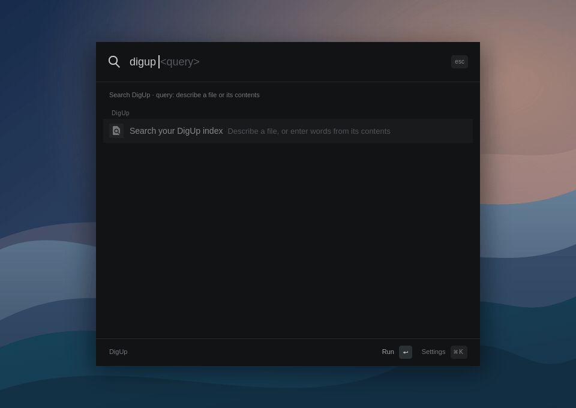

# DigUpLinux

Search local Linux files by their contents: natural-language descriptions,
exact words, images, PDF pages, code, and moments inside audio and video.
Inspired by [DigUp](https://github.com/ARahim3/DigUp).

<p align="center">
  
  <br>
  <sub>Real Keystroke interface · sample documents · keyword-only search</sub>
</p>

Use the CLI from your terminal or the included
[Keystroke extension](extensions/keystroke-digup/README.md) from your launcher.
Find a document by its contents, inspect the matching passage, and open the file.

This first version is a Python CLI with a native llama.cpp worker. It uses the
same quantized EmbeddingGemma 2 model as DigUp. Indexing and search run locally;
only the explicit setup commands download source code or weights.

## Install

Python 3.11+, Git, CMake and a C++17 compiler are required for semantic search.
Install the file readers for the formats you want to index:

```bash
# Arch Linux
sudo pacman -S python python-pip git cmake gcc ffmpeg poppler tesseract tesseract-data-eng

# Debian / Ubuntu
sudo apt install python3 python3-venv git cmake g++ ffmpeg poppler-utils tesseract-ocr
```

Clone the project and install the CLI:

```bash
git clone https://github.com/rdbell/diguplinux.git
cd diguplinux
python3 -m venv .venv
source .venv/bin/activate
pip install -e .
digup setup
digup doctor
```

`setup` builds the pinned CPU worker and downloads about 865 MB of model
weights. Each file is verified against its SHA-256 before installation. Run
`digup setup` again to verify installed models and rebuild the worker as needed.
Use `digup runtime` to rebuild only the worker or `digup models download` for
only the weights.

For a first trial without a model or compiler:

```bash
digup index ~/Documents --keyword-only
digup search "invoice 12345" --keyword-only
```

## Use

Only folders you explicitly name are indexed. The first pass does the heavy
work; subsequent passes skip files whose size, modification time and indexing
options have not changed. Removed or excluded files are pruned within the
folders supplied to that pass.

```bash
digup index ~/Documents ~/Pictures
digup search "the clause about pets in the lease"
digup search "a tree under the sun" --kind image
digup search "where they talk about sleep" --kind audio
digup search "a dog on the beach" --kind video
digup search "invoice 12345" --keyword-only
digup status
digup config
digup index                 # update all saved folders with their saved options
digup watch
```

Results include a path and a matching page, line, notebook cell or timestamp.
The CLI reports the best match per file. It does not open a viewer automatically.
`index` saves folder selections and options in the separate config before
starting extraction. With no folder arguments, it updates all folders saved
for the selected index. Supply explicit folders when changing their options.
`watch` polls saved folders every ten seconds and reloads their configuration
between passes. Stop with Ctrl-C; `watch --once` performs one pass.

Code lives in a separate collection:

```bash
digup index ~/projects/my-app --code
digup search "code: retry a failed network call with backoff"
digup search refreshAccessToken --code --keyword-only
```

Code indexing honors Git's ignored files and skips notebook outputs. Normal
file indexing skips documents and code inside detected projects, but includes
their images. Hidden files/directories, symlinks, common credential files,
private-key files, vendored dependencies and build outputs are skipped. These
exclusions are heuristics; choose roots and exclusions appropriate to your files.

```bash
digup index ~/Documents --exclude ~/Documents/private --exclude-ext csv,log
digup index ~/Documents --ignore-pattern '**/drafts/**' --ignore-pattern '*.tmp'
digup index ~/Pictures --ocr-language eng+spa
digup index ~/Videos --video-interval 10 --max-segments 10000
digup index ~/Documents --reindex
digup index --device gpu --verbose
```

`--verbose` shows scanning, model loading, each file and segment, and elapsed
time on stderr. A percentage tracks changed files processed, including failed
attempts; it measures file count, not remaining time. Unchanged and skipped
files are excluded. Each saved folder gets its own percentage. It also works
with saved folders and `--json`; stdout retains
the usual summary or JSON result.

Install the corresponding Tesseract language packs before changing the OCR
language. Extraction failures are reported, saved in `status`, and retried on
the next pass. A failed replacement keeps the previously indexed version of
that file, so its search results can be stale until extraction succeeds.

Ignore patterns are case-sensitive and relative to each indexed root. A pattern
without `/` matches names at any depth; `*`, `?`, and `[abc]` match within one
path component, while `**` spans zero or more components. A trailing `/` matches
directories only. Matching directories are skipped entirely, so their contents
are not counted in `skipped`. Absolute patterns, `..` components, and `!`
negation are unsupported. Quote CLI patterns to prevent shell expansion.
Patterns are saved per folder and reused by `index` and `watch`; newly ignored
files are removed from the index on the next successful scan. Changing patterns,
excluded paths, or excluded extensions preserves cached content and embeddings
for unchanged files that remain included.

## Supported formats

| Files | Indexed content |
| --- | --- |
| TXT, Markdown, RST, CSV, logs, HTML | Text passages with line references |
| DOCX, ODT | Document text; formatting and embedded images are omitted |
| PDFs | Rendered pages, text passages and OCR for pages without text |
| JPEG, PNG, WebP, TIFF, HEIC and other FFmpeg-readable images | Visual content plus OCR when Tesseract is installed |
| MP3, WAV, FLAC, M4A, OGG and other supported audio | 30-second windows, with a 20-second hop |
| MP4, MKV, MOV, WebM and other supported video | Frames every five seconds, plus audio windows |
| Common source files, notebooks and project docs | Text chunks with line/cell references, in the code collection |

Legacy DOC/RTF and camera RAW files are not supported yet. Audio is embedded
directly without transcription, so spoken invoice numbers are not indexed for
exact keyword search. Video uses periodic sampling, so very brief events can
be missed. Images and PDF pages are resized before embedding and OCR; small
text may be missed.

Text files and expanded document XML are limited to 20 MiB. Files exceeding
the default 5,000 segment/page/window limit fail with a message rather than
being silently truncated. Increase `--max-segments` when needed. Text files
must be UTF-8. Symbol-aware code chunking and desktop integration remain future
work.

## Storage and scripting

Defaults follow Linux's XDG directories:

- Config: `$XDG_CONFIG_HOME/diguplinux/config.toml`
- Index: `$XDG_STATE_HOME/diguplinux/index/index.sqlite`
- Models: `$XDG_DATA_HOME/diguplinux/models/`
- Worker: `$XDG_DATA_HOME/diguplinux/bin/digup-worker`
- Runtime source and build: `$XDG_CACHE_HOME/diguplinux/runtime/`

Config defaults to `~/.config`, state to `~/.local/state`, data to
`~/.local/share`, and cache to `~/.cache`. Unset, empty or relative
`XDG_CONFIG_HOME` and `XDG_STATE_HOME` use their defaults. Use `--index` and
`--config` before or after a subcommand to select a different index or config.
`DIGUP_MODELS` and `DIGUP_WORKER` override the model folder and worker executable.

Existing indexes in the former `~/.local/share/diguplinux/index` location are
not moved automatically. Use `--index ~/.local/share/diguplinux/index` to keep
using one.

## Configuration and backups

`config.toml` is the source of truth for selected folders and their options.
Each index directory has its own folder list in that file. The database holds
extracted content, embeddings, file fingerprints and extraction failures.

```toml
version = 1

[[indexes]]
path = "/home/alex/.local/state/diguplinux/index"

[[indexes.folders]]
path = "/home/alex/Documents"
collection = "files"
keyword_only = false
excludes = ["/home/alex/Documents/private"]
exclude_ext = [".csv"]
ignore_patterns = ["**/drafts/**", "*.tmp"]
language = "eng"
max_segments = 5000
video_interval = 5

[[indexes.folders]]
path = "/home/alex/projects/my-app"
collection = "code"
```

Folder options may be omitted to use their defaults. Paths must be absolute;
when restoring on a different machine, update the index and folder paths as
needed. You can edit the config manually; `digup index <folder>` rewrites it
and does not preserve comments. Removing a folder entry stops future indexing
of it; previously cached results remain until you rebuild the database.

Config saves use a file lock, a private temporary file, fsync and atomic
replacement. New config files use mode 0600 and their directory uses 0700.
Invalid configs are reported rather than reset or overwritten. A small
`config.toml.lock` file remains alongside the config; it needs no backup.

Back up `config.toml` and any environment overrides in your shell configuration.
Backing up the database is optional and saves the cost of reindexing. Stop
indexing before copying its directory, or use SQLite's backup API for a live
backup. Model weights can be downloaded again; the worker and runtime cache
can be rebuilt.

If the index directory is missing, `digup index` or `digup watch --once`
recreates it from the saved folders and their options. If the database is
corrupted, stop indexing and preserve the index directory by moving it aside
to an unused backup path. Then run `digup index` with the same `--index` and
`--config` selections. The tool never automatically discards a damaged database.
`digup config` displays saved folders without opening SQLite and remains usable
when the database is missing or corrupt.

On the first `index` or `watch` invocation for an older database, its stored
folder list is imported into the config if that index has no config entry yet.
An existing config entry always takes precedence. If the older database is
already unreadable and its folders were never exported, they must be supplied
again after preserving the damaged index.

## Scripting

```bash
digup --index /tmp/my-search-index index ~/Documents
digup search "rental agreement" --index /tmp/my-search-index --json
digup search "invoice" --keyword-only --paths
digup search "invoice" --keyword-only -0 | xargs -0 -r ls -l --
```

`--json` keeps progress on stderr and results on stdout. Indexing returns a
nonzero exit code if any file fails. Search returns an empty list for no matches.
Indexes contain extracted text and embeddings; keep them private like the
original files. New index directories use mode 0700 and databases use 0600.
Source files are never modified. Concurrent searches read a stable SQLite
snapshot while a single writer updates files atomically.

Semantic search scans stored vectors in Python, which is suitable for an
initial personal index. Large libraries will need a faster vector backend.
CPU and Vulkan inference have been exercised on this Linux ARM64 machine with
an Apple M2 Max GPU and Asahi's Honeykrisp driver. CUDA is available but untested.
GPU workers are installed separately, preserving the CPU worker:

```bash
# Requires the matching GPU development packages/drivers and shader compiler
digup runtime --backend vulkan
digup index ~/Documents --device gpu
digup search "rental agreement" --device gpu
digup index --device cpu

# NVIDIA systems can build with --backend cuda instead
```

CPU is the default. Set `DIGUP_DEVICE=gpu` in your environment to default to
GPU inference, or select `--device` before or after the subcommand. `DIGUP_THREADS`
sets worker CPU threads (default: up to eight); `DIGUP_GPU_LAYERS` optionally
controls GPU offload (default: 999 in GPU mode). Explicit CPU mode forces zero
offloaded layers. The worker reports its backend and hardware device, and GPU
mode fails rather than silently running on the CPU or a software Vulkan device.

Vulkan uses float32 compute for EmbeddingGemma 2 to avoid overflowing float16
activations. File extraction, PDF rendering, OCR and media decoding remain on
the CPU. Changing the inference device does not itself reindex unchanged files;
use `--reindex` to regenerate their embeddings.

## Development

The core CLI has no third-party Python dependencies. Local inference uses
llama.cpp `b11461`, pinned to its commit, with DigUp's non-causal embedding
memory patch. SQLite FTS5 supplies keyword search; normalized 768-dimensional
vectors supply semantic search. Ranking combines the two with reciprocal rank
fusion, downweighting partial keyword matches and common English words.
Changing the model/preprocessing pipeline requires a version bump and reindex.

```bash
python -m unittest discover -s tests -v
pip install ruff build
ruff check src tests
ruff format --check src tests
python -m build

# Also exercise the real local model and system readers after setup
DIGUP_INTEGRATION=1 python -m unittest discover -s tests -v
```

Tests use temporary folders and indexes; they do not scan your personal files.
Config tests use temporary config files and cover legacy import, interrupted
saves, invalid configuration and rebuilding after database loss or corruption.
See [THIRD_PARTY_NOTICES.md](THIRD_PARTY_NOTICES.md) for upstream attribution.
DigUpLinux is not affiliated with DigUp or Google.

## Keystroke launcher extension

The [DigUp extension](extensions/keystroke-digup/README.md) searches this index
from Omarchy's Keystroke launcher. It lives alongside the CLI in
`extensions/keystroke-digup`; link it with:

```bash
python3 extensions/keystroke-digup/bin/install
```

Enable **DigUp** in Keystroke's `ext` menu, then type `digup <query>`.
Enter opens a result; Ctrl+Enter copies its path. Extension settings select
CPU/GPU or keyword-only search and an optional alternate index directory.

The [demo renderer](tools/render-demo.py) uses a separate offscreen Keystroke
instance and a temporary keyword-only index of synthetic documents. To regenerate
`assets/demo.gif`, install Quickshell, FFmpeg and `rsvg-convert`, then run:

```bash
python3 tools/render-demo.py --digup /absolute/path/to/digup \
  --keystroke /path/to/keystroke
```

It does not read your personal index or change the running desktop shell.
